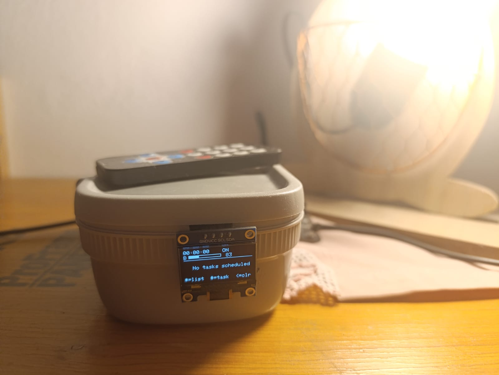

# ESP32 TRIAC Lamp Dimmer

A smart lamp dimmer powered by **ESP32** and controlled with a regular **IR remote**. It can also turn the lamp on and off by schedule and simulate sunrise and sunset.



## Hardware

- **MCU:** ESP32
- **Dimmer:** TRIAC with zero-cross detector
- **Controls:** IR receiver and remote
- **Clock:** DS3231 RTC
- **Output:** Display and buzzer

| Signal           | GPIO                  |
| ---------------- | --------------------- |
| Zero-cross input | 18                    |
| TRIAC gate       | 19                    |
| IR receiver      | 4                     |
| DS3231           | I²C (default SDA/SCL) |

> ⚠️ The TRIAC side is connected to mains voltage. Use an optically isolated dimmer module and an insulated enclosure.

## Software & Features

- Written in C++ with the Arduino framework (ESP32 core 3.x).
- Smooth brightness control using zero-cross detection and a hardware timer.
- Control with an IR remote: brightness up/down, on/off.
- Scheduler with 4 task types: **ON**, **OFF**, **SUNRISE**, **SUNSET**.
- Tasks are entered right from the remote, no PC needed.
- Status display with time, brightness and lamp state.
- Serial log for debugging (9600 baud).

Libraries: [IRremote](https://github.com/Arduino-IRremote/Arduino-IRremote), [RTClib](https://github.com/adafruit/RTClib).

## IR Remote

| Key           | Action          |
| ------------- | --------------- |
| `UP` / `DOWN` | Brightness +/-  |
| `OK`          | Lamp on/off     |
| `#`           | New task        |
| `*`           | Show task list  |
| `LEFT`        | Clear all tasks |
| `RIGHT`       | Show time       |

The key codes are for one specific remote. For another remote, change the `IR_*` codes at the top of the sketch.

## Adding a Task

Press `#`, type 7 digits, press `OK`:

```
C HH MM DD
```

- `C` — command: `1` ON, `2` OFF, `3` SUNRISE, `4` SUNSET
- `HH:MM` — start time
- `DD` — fade duration in minutes (for sunrise/sunset only)

Examples:

- `1 07 30 00` — turn on at 07:30
- `2 23 00 00` — turn off at 23:00
- `3 06 45 30` — 30-minute sunrise starting at 06:45

While typing, `*` is backspace and `#` cancels.

## How It Works

1. On every AC half-cycle the zero-cross detector triggers an interrupt.
2. The firing delay is calculated from the current brightness and a hardware timer is started.
3. When the timer fires, a short pulse opens the TRIAC until the next zero crossing.

The later the pulse, the dimmer the lamp.
